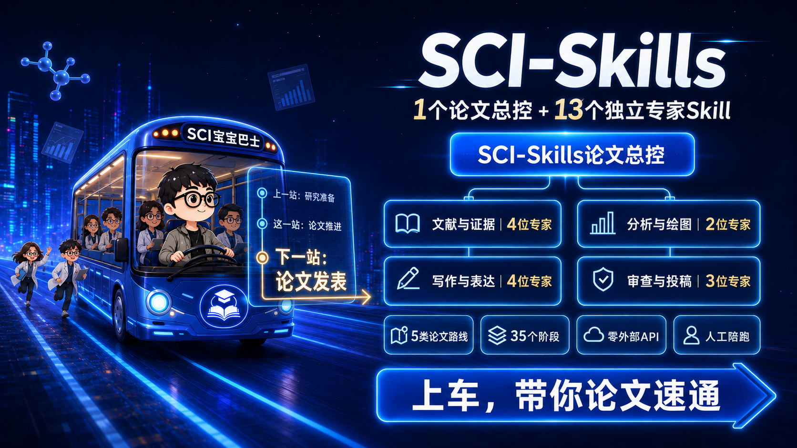

# SCI-Skills



> **晚风老师打造的分阶段、全流程论文协作 Skill 套件。上车，带你论文速通。**

SCI-Skills 由 **1 个论文总控 Skill** 和 **13 个可独立运行的专家 Skill** 组成，覆盖实证类、阐释类、方法应用类、理论类和综述类五条论文路线，共 35 个阶段。

它不会一次性拼接一篇看似完整的论文，而是根据用户已有的方向、文献、数据、代码、实验、草稿和投稿目标，判断当前真正所处的阶段，完成本阶段任务、检查证据与质量，再推进到下一阶段。

> **全流程论文辅导、科研合作**


## 核心特点

- **分阶段全流程推进**：保留五类论文路线和 35 个阶段，不因本次目录调整而改变。
- **总控负责验收**：只有 `sci-skills` 总控可以确认阶段通过、回退或进入下一阶段。
- **13 位独立专家**：专家既可以被总控调度，也可以单独处理边界明确的论文任务。
- **零外部 API 主线**：小白也能轻松上手，无捆绑，不要求 API Key、第三方接口或远程模型服务。
- **保留人工陪跑**：需要操作数据库、网页、软件或投稿系统时，提供可复制到新对话的陪跑 Prompt，并允许用户用截图继续询问。
- **证据与学术诚信优先**：不虚构论文、数据、统计结果、图像结果、期刊指标或投稿状态。

## 一键安装

下载zip，拖动给任意Agent（codex，claude，workbuddy），输入：

```text
帮我安装这个skill，就安装在这个项目，不要影响其他项目。
```

安装完成后，在新对话中发送下面任意一个名称即可开始：

```text
宝宝巴士
```

或：

```text
山海
```

也可以直接描述当前情况，例如：

```text
我只有一个研究方向，还没有确定题目，请带我从选题开始。
```

```text
我已经有数据、代码和部分结果，请判断我目前处于哪个阶段。
```

```text
我已经写完初稿，请先做投稿前审查，再根据论文质量推荐期刊。
```

## 工作方式

```text
用户材料
   ↓
SCI-Skills 总控：识别论文类型与当前阶段
   ↓
选择最小必要专家组合并派发任务
   ↓
专家返回产物、证据状态、缺失信息和风险
   ↓
SCI-Skills 总控：验收、修复或推进下一阶段
```

## 13 位专家

| 分组 | 专家 Skill | 主要任务 |
| --- | --- | --- |
| 文献与证据 | `sci-skills-literature-search` | 检索设计、文献发现、引用核验与证据矩阵 |
| 文献与证据 | `sci-skills-paper-deep-reading` | 方法重建、实验—结论证据链与结论边界 |
| 文献与证据 | `sci-skills-web-data-acquisition` | 数据确实不足时的合规获取和人工回传 |
| 文献与证据 | `sci-skills-data-availability` | 数据与代码清单、共享计划和可用性声明 |
| 分析与绘图 | `sci-skills-statistical-reporting` | 统计设计、计算证据、效应量和规范报告 |
| 分析与绘图 | `sci-skills-scientific-figures` | 真实数据图、算法结构图、流程图与图件质检 |
| 写作与表达 | `sci-skills-manuscript-writing` | 论文结构、章节写作与证据约束下的重构 |
| 写作与表达 | `sci-skills-academic-polishing` | 中英文润色、翻译和术语一致性 |
| 写作与表达 | `sci-skills-aigc-authorial-rewriting` | AIGC 风险审查与基于真实作者判断的改写 |
| 写作与表达 | `sci-skills-paper-presentation` | 组会、答辩和会议汇报 PPT |
| 审查与投稿 | `sci-skills-presubmission-review` | 投稿前模拟审查与论文完整性检查 |
| 审查与投稿 | `sci-skills-reviewer-response` | 审稿意见拆解、修改地图与逐点回复 |
| 审查与投稿 | `sci-skills-journal-recommendation` | 先评估论文质量，再推荐冲刺、目标和保底期刊 |

更完整的输入、输出与边界见 [专家目录](./docs/expert-catalog.md)。

## 五类论文路线

| 路线 | 代码 | 主要贡献判断 |
| --- | --- | --- |
| 实证类 | E1–E7 | 用数据和分析回答研究问题 |
| 阐释类 | I1–I7 | 通过材料、文本或案例形成解释 |
| 方法应用类 | M1–M7 | 提出、改进或验证方法与应用系统 |
| 理论类 | T1–T7 | 构建、修订或检验概念与理论关系 |
| 综述类 | R1–R7 | 系统组织文献并形成可核验的知识综合 |

路线按论文的主要贡献判断，而不是按学科名称或是否使用 AI 判断。详见 [论文路线说明](./docs/paper-routes.md)。

## 学术安全底线

- 结果图必须来自真实数据、明确变换、可执行代码和已核验输出。
- 示意图、流程图和算法结构图必须先说明拟放位置、目的、内容和拆图方案，再由用户确认是否生成。
- 参考图可以借鉴布局和证据表达，但不能复制受保护表达、伪造来源或把示意图包装成实验结果。
- AIGC 作者化改写不承诺检测器分数，不以规避检测为目标，不改变科学含义。
- 期刊指标、分区、范围和投稿要求属于动态事实，必须核验后再使用。

完整规则见 [学术安全与人工陪跑](./docs/academic-safety.md)。

## 文件结构

```text
SCI-Skills-3.0.2/
├── README.md
├── LICENSE
├── NOTICE
├── VERSION
├── suite.yaml
├── assets/
├── docs/
├── skills/                 # 14 个平铺、可独立识别的 Skill 根目录
├── validation/             # 发布结构与触发前置条件检查
└── VALIDATION.md           # 结构与回归测试结果
```

`skills/` 中不设置多级专家分类目录，避免自动发现机制只扫描一层时漏掉 Skill。逻辑分类由本 README 和 `suite.yaml` 负责。

## 品牌与作者

安装名、展示名和产品宣传名统一使用 **SCI-Skills**。

SCI-Skills 由 **晚风老师** 打造；“宝宝巴士”和“山海”均为可用昵称。
